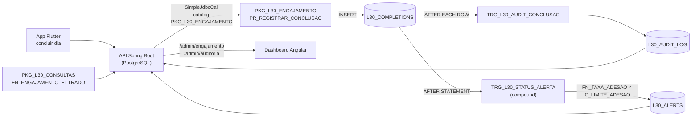
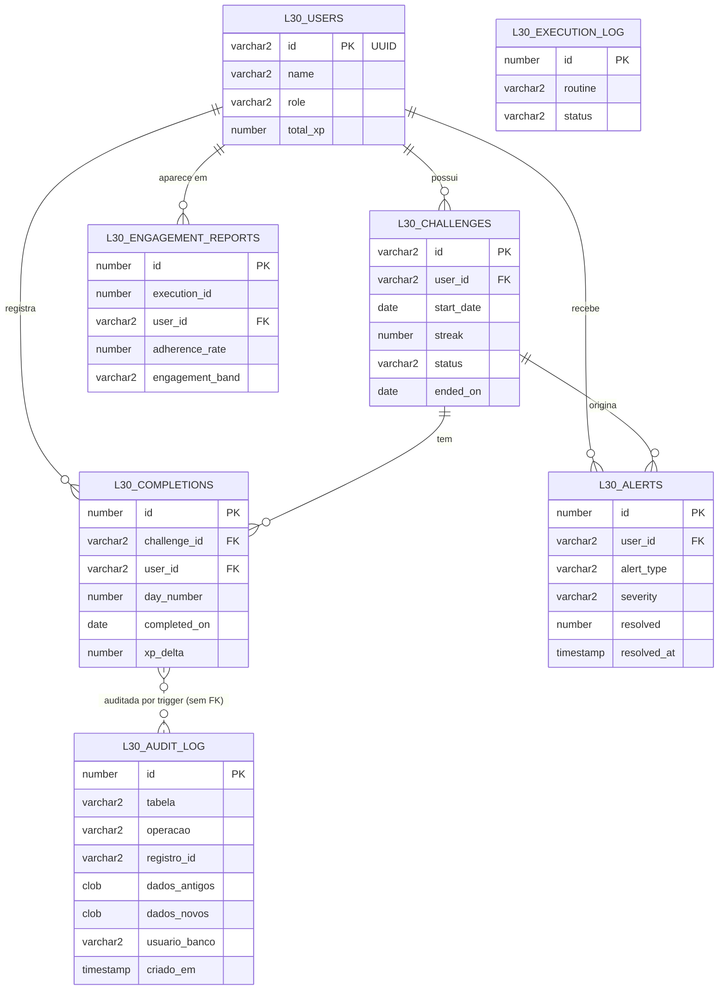

# Fase 7 — Objetos PL/SQL do Smart HAS

Camada Oracle de inteligência do Level30 (o PostgreSQL segue como banco transacional; ver
`db/oracle/README.md`). Todos os objetos novos usam `PKG_L30_` / `TRG_L30_` / `L30_`, para conviver
com outros projetos no mesmo schema (usuário RM da FIAP).

## Objetos

| Objeto | Tipo | Finalidade | Valor para o Smart HAS |
|---|---|---|---|
| `PKG_L30_ENGAJAMENTO` | Package | Reúne `FN_TAXA_ADESAO`, `FN_RESUMO_USUARIO`, `PR_REGISTRAR_CONCLUSAO`, `PR_GERAR_RELATORIO_ENGAJAMENTO`, a meta `C_LIMITE_ADESAO` e as exceptions nomeadas | Uma única porta de entrada para as regras de engajamento: o Java chama `PKG_L30_ENGAJAMENTO.*`, a meta de 50 % vive em um só lugar e as validações privadas não vazam |
| `PKG_L30_ENGAJAMENTO.FN_TAXA_ADESAO` | Function | % de dias com conclusão sobre os dias com desafio aberto (padrão: 30 dias) | O indicador central: diz quem está aderindo ao hábito de 30 dias |
| `PKG_L30_ENGAJAMENTO.FN_RESUMO_USUARIO` | Function | Linha pronta: nome, XP, desafios ativos, streak e adesão | Cartão do aluno no dashboard sem montar texto no Java |
| `PKG_L30_ENGAJAMENTO.PR_REGISTRAR_CONCLUSAO` | Procedure | Replica usuário/desafio, grava o evento (idempotente), resolve inatividade e avisa streak reiniciado | Ingestão em tempo real a cada "concluir dia" do app, sem ETL |
| `PKG_L30_ENGAJAMENTO.PR_GERAR_RELATORIO_ENGAJAMENTO` | Procedure | Relatório por aluno e período, com faixa ALTO/MODERADO/EM_RISCO/CRITICO | Visão gerencial do programa: quantos alunos em cada faixa |
| `PKG_L30_CONSULTAS` | Package | Consultas dinâmicas | Consulta ad hoc do dashboard sem uma procedure por combinação de filtros |
| `PKG_L30_CONSULTAS.FN_ENGAJAMENTO_FILTRADO` | Function (REF CURSOR) | Engajamento por aluno com filtros opcionais e ordenação escolhida, via Dynamic SQL seguro | Admin filtra por período, nível e adesão e ordena por adesão/streak/nome/nível |
| `TRG_L30_AUDIT_CONCLUSAO` | Trigger de linha (AFTER I/U/D) | Grava antes/depois em JSON e o usuário de banco em `L30_AUDIT_LOG` | Rastreabilidade: quem alterou ou apagou uma conclusão (conclusões valem XP) |
| `TRG_L30_STATUS_ALERTA` | Compound trigger | Abre/mantém/fecha o alerta `ADESAO_BAIXA` conforme a adesão de 30 dias | Fonte única da regra de risco de abandono; o alerta aparece e some sozinho |
| `L30_AUDIT_LOG` | Tabela | Registros de auditoria (`TABELA`, `OPERACAO` I/U/D, `REGISTRO_ID`, `DADOS_ANTIGOS`/`DADOS_NOVOS` em JSON, `USUARIO_BANCO`, `CRIADO_EM`) | Base da tela de auditoria do dashboard |
| `PR_VERIFICAR_INATIVIDADE`, `PR_LOG_EXECUCAO` | Procedures standalone (Fase 6) | Alerta de inatividade em lote; log em transação autônoma | Mantidas fora do package porque o job `05` e todas as rotinas as usam |

Scripts em `db/oracle/`: `06_pkg_engajamento` · `07_trg_audit_conclusao` · `08_trg_status_alerta` ·
`09_pkg_consultas` · `10_consolidacao` (remove as rotinas standalone antigas) · `99_smoke_test`.
O `00_drop.sql` remove tudo, incluindo packages, triggers e `L30_AUDIT_LOG`.

## Fluxo



## DER



`L30_AUDIT_LOG` não tem FK de propósito: a auditoria precisa sobreviver ao `DELETE` em cascata das
linhas que audita.

## Decisões sobre as triggers

- **Mutating table.** O cálculo da adesão lê `L30_COMPLETIONS`. Numa trigger de linha isso daria
  ORA-04091. A compound trigger só acumula o `user_id` em `AFTER EACH ROW` (coleção associativa indexada
  pelo próprio `user_id`, então sem duplicatas) e calcula em `AFTER STATEMENT`, quando a tabela já pode ser lida.
- **Eventos.** `INSERT` e `UPDATE OF user_id, completed_on`. `DELETE` não reavalia o alerta: conclusões só
  são apagadas por cascata (usuário/desafio removido), e reavaliar um usuário em remoção reintroduz o erro de
  tabela mutante. O `DELETE` é registrado pela trigger de auditoria.
- **Alerta.** "Aberto/resolvido" usa as colunas que já existiam (`RESOLVED` 0/1, `RESOLVED_AT`); nenhum `ALTER`.
  Adesão `NULL` (sem desafio no período) não muda nada. A fonte da regra é só a trigger: `PR_REGISTRAR_CONCLUSAO`
  não gera mais `ADESAO_BAIXA`, então `p_alertas_gerados` conta apenas os alertas da procedure (`STREAK_REINICIADO`).

## Dynamic SQL com segurança

`PKG_L30_CONSULTAS.FN_ENGAJAMENTO_FILTRADO` tem duas categorias de entrada, tratadas de forma diferente:

1. **Valores** (`p_inicio`, `p_fim`, `p_nivel_min`, `p_adesao_min`) entram **sempre por bind**
   (`OPEN v_cur FOR v_sql USING ...`). Nenhum valor é concatenado ao texto do SQL.
   O número de binds é fixo (4): em vez de montar o `WHERE` só com os filtros presentes, o texto usa o padrão
   `(:b IS NULL OR coluna >= :b)` sobre uma CTE `p` que carrega cada valor uma única vez
   (`SELECT :b_inicio, :b_fim, ... FROM dual`). Filtro nulo vira condição verdadeira. Escolhido no lugar de
   `DBMS_SQL` por ser mais simples e manter um único cursor compartilhável pelo Oracle.
2. **Identificadores** (`p_ordenar_por`, `p_direcao`) **não aceitam bind**, então passam por *whitelist*:
   um `CASE` mapeia cada opção permitida (`ADESAO|STREAK|NOME|NIVEL`, `ASC|DESC`) para o nome real da coluna
   ou palavra-chave. Qualquer outro valor devolve `NULL` no `CASE` e dispara
   `RAISE_APPLICATION_ERROR(-20050, ...)` antes de qualquer SQL ser montado. O identificador resultante ainda
   passa por `DBMS_ASSERT.SIMPLE_SQL_NAME` como defesa extra.
3. **Log.** Com `c_debug = TRUE` o texto final do SQL (sem valores) vai para `DBMS_OUTPUT`.

**Defesa em profundidade no Java.** `OrdenacaoEngajamento` e `DirecaoOrdenacao` (enums) validam os parâmetros do
`GET /admin/engajamento` (400 se inválidos) e só o `name()` do enum chega ao banco.

**Teste de injeção.** `99_smoke_test.sql` chama `p_ordenar_por => 'X; DROP TABLE l30_users'` e
`p_direcao => 'DESC, (SELECT 1 FROM dual)'`, exige ORA-20050 e confere que o número de tabelas `L30_` não mudou.
O IT `injecaoNaOrdenacao_barradaPelaWhitelistDoPlsql` repete o ataque direto no PL/SQL (contornando o enum Java),
e `EngajamentoFiltradoValidacaoTest` cobre o enum.

## Exemplos para o SQL Developer

```sql
-- Adesão dos últimos 30 dias e dos últimos 7
SELECT pkg_l30_engajamento.fn_taxa_adesao(id)                                AS adesao_30d,
       pkg_l30_engajamento.fn_taxa_adesao(id, TRUNC(SYSDATE) - 6, TRUNC(SYSDATE)) AS adesao_7d
  FROM l30_users WHERE role = 'USER' AND ROWNUM = 1;

-- Resumo formatado
SELECT pkg_l30_engajamento.fn_resumo_usuario(id) FROM l30_users WHERE role = 'USER' AND ROWNUM <= 3;

-- Registrar uma conclusão (o Java faz o mesmo via JDBC) e ver o efeito das triggers
DECLARE v_alertas NUMBER;
BEGIN
  pkg_l30_engajamento.pr_registrar_conclusao(
    p_user_id => 'demo-user', p_user_name => 'Aluno Demo', p_total_xp => 10,
    p_challenge_id => 'demo-challenge', p_title => 'Beber água',
    p_start_date => TRUNC(SYSDATE) - 10, p_day_number => 1, p_streak => 1,
    p_completed_on => TRUNC(SYSDATE), p_xp_delta => 10, p_alertas_gerados => v_alertas);
  COMMIT;
END;
/
SELECT operacao, registro_id, dados_novos, usuario_banco, criado_em FROM l30_audit_log ORDER BY id DESC FETCH FIRST 5 ROWS ONLY;
SELECT alert_type, severity, message, resolved FROM l30_alerts WHERE user_id = 'demo-user';

-- Relatório do período
DECLARE v_exec NUMBER;
BEGIN
  pkg_l30_engajamento.pr_gerar_relatorio_engajamento(TRUNC(SYSDATE) - 29, TRUNC(SYSDATE), v_exec);
  DBMS_OUTPUT.PUT_LINE('execucao ' || v_exec);
END;
/

-- Dynamic SQL: alunos de nível >= 2 com adesão >= 50%, por streak
VAR rc REFCURSOR
EXEC :rc := pkg_l30_consultas.fn_engajamento_filtrado(NULL, NULL, 2, 50, 'STREAK', 'DESC');
PRINT rc

-- Tentativa de injeção (deve falhar com ORA-20050)
EXEC :rc := pkg_l30_consultas.fn_engajamento_filtrado(p_ordenar_por => 'X; DROP TABLE l30_users');

-- Limpeza do exemplo
DELETE FROM l30_users WHERE id = 'demo-user';
COMMIT;
```

## API e dashboard

| Endpoint (ADMIN) | Chama |
|---|---|
| `GET /admin/engajamento?inicio=&fim=&nivelMin=&adesaoMin=&ordenarPor=&direcao=` | `PKG_L30_CONSULTAS.FN_ENGAJAMENTO_FILTRADO` |
| `GET /admin/auditoria?limite=50` (1..500) | `SELECT` em `L30_AUDIT_LOG` |
| `POST /admin/engajamento/relatorios`, `GET .../alertas`, ... | inalterados (agora via `PKG_L30_ENGAJAMENTO`) |

O prompt pedia `/api/engajamento` e `/api/auditoria`; a API não usa o prefixo `/api` e a auditoria expõe dados
de usuários, então os endpoints ficam em `/admin/**` com `ROLE_ADMIN` (ver `00_DESCOBERTA.md`). Na tela
"Engajamento — camada Oracle" do dashboard ficam a consulta filtrada e a tabela de auditoria.
