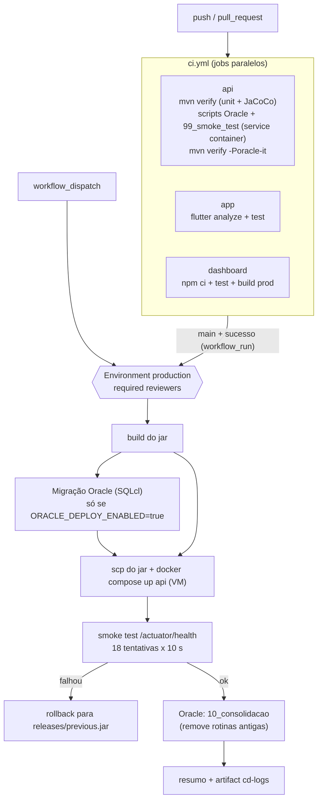

# Fase 7 — Pipeline CI/CD (GitHub Actions)

Workflows: [`ci.yml`](../../.github/workflows/ci.yml) e [`cd.yml`](../../.github/workflows/cd.yml).
O `secret-scan.yml` (gitleaks) continua rodando em paralelo.

## Jobs do CI

| Job | O que faz | Observações |
|---|---|---|
| `api` | JDK 21 (cache Maven) → `mvn verify` (unitários, JaCoCo) → aplica `00_drop, 01, 02, 03, 06..10` e `99_smoke_test` no Oracle → `mvn verify -Poracle-it` | Falha se o log tiver `ORA-/PLS-/SP2-` ou se `USER_ERRORS` não for 0 |
| `app` | `flutter pub get`, `flutter analyze`, `flutter test` | Os 33 lints antigos foram corrigidos (`dart fix`); o gate é estrito |
| `dashboard` | `npm ci`, `npm test` (Karma/Chrome headless), `ng build --configuration production` | |

**Oracle no CI.** Escolhido um *service container* (`gvenzl/oracle-free:23-slim-faststart`, porta 1521,
serviço `FREEPDB1`, `--health-cmd healthcheck.sh`) porque o smoke test em SQL*Plus precisa de um banco
persistente entre os passos. O teste de integração Java reaproveita o mesmo banco
(`ORACLE_IT_URL/USER/PASSWORD`, preenchidos no próprio job); sem essas variáveis ele sobe um Oracle via
Testcontainers, que é o modo local. As senhas são derivadas de `github.run_id`/`run_attempt`: descartáveis,
existem só enquanto o job vive, e **não são secrets**. Não há Flyway no Oracle (o Flyway da API é só
PostgreSQL), então os scripts são aplicados com `docker cp` + `sqlplus`.

## Logs e relatórios

| O quê | Onde (aba *Actions* → execução → *Artifacts*) |
|---|---|
| Logs do `api` (unit, scripts Oracle, IT) | `api-logs` |
| Surefire/Failsafe + JaCoCo (`site/jacoco/index.html`) | `api-relatorios` |
| Resumo de testes e cobertura | *Summary* da execução (`$GITHUB_STEP_SUMMARY`) |
| Logs do `app` / `dashboard` | `app-logs` / `dashboard-logs` |
| Logs e resumo do deploy | `cd-logs` + *Summary* do `cd` |

## CD

Dispara quando o `ci` termina com sucesso na `main`, ou manualmente (`workflow_dispatch`). O job usa o
**Environment `production` com required reviewers**: nada é feito antes da aprovação.

1. Build do jar (`mvn -DskipTests clean package`).
2. **Migração Oracle** (SQLcl) — só se `vars.ORACLE_DEPLOY_ENABLED == 'true'`, em duas etapas. Antes do
   deploy: `06..09` (só criam objetos; falha se `USER_ERRORS > 0`). Depois do smoke test verde:
   `10_consolidacao` (apaga as rotinas standalone antigas). O schema base (`01..03`) é pré-requisito.
3. **Deploy na VM por SSH** — copia o jar para `~/Level30-Flutter/releases/`, guarda o jar atual como
   `releases/previous.jar`, troca o jar em `backend/target/` e roda `docker compose up -d --build api`.
   Não toca em `docker-compose.yml`, `.env` nem na heap (`-Xmx320m`, VM de 1 GB).
4. **Smoke test** em `/actuator/health` (já exposto só com `health` no profile `prod`), até 18 tentativas.
   Falhou → restaura `releases/previous.jar`.
5. Resumo (commit, versão, migração, deploy, smoke) e artifact `cd-logs`.

## Secrets e variables (sem valores)

Cadastre em *Settings → Secrets and variables → Actions*. Os marcados com **E** devem ficar no
Environment `production` (e não no repositório).

| Nome | Tipo | Onde | Obrigatório | Uso |
|---|---|---|---|---|
| `VM_HOST` | secret | E | sim | host/IP da VM Oracle Cloud |
| `VM_USER` | secret | E | sim | usuário SSH (`ubuntu`) |
| `VM_SSH_KEY` | secret | E | sim | chave privada SSH do deploy (conteúdo completo) |
| `VM_KNOWN_HOSTS` | secret | E | recomendado | saída de `ssh-keyscan` da VM; sem ele o job usa `ssh-keyscan` no primeiro contato (aviso) |
| `ORACLE_URL` | secret | E | se migrar Oracle | formato EZConnect `host:porta/servico` |
| `ORACLE_USER` | secret | E | se migrar Oracle | usuário (RM) |
| `ORACLE_PASSWORD` | secret | E | se migrar Oracle | senha |
| `ORACLE_DEPLOY_ENABLED` | variable | E | não | `true` liga a migração Oracle no CD (padrão: desligada) |
| `API_HEALTH_URL` | variable | E | não | padrão `https://api.level30.online/actuator/health` |

O CI não usa nenhum secret (apenas o `GITHUB_TOKEN` do `secret-scan`).

## Environment `production`

*Settings → Environments → New environment → `production`* → **Required reviewers** (você) → *Deployment
branches*: apenas `main`. Sem isso o `cd` não tem a parada de aprovação.

## Verificar o CI

Faça push da branch `fase7` e acompanhe em *Actions → ci*. Os três jobs (`api`, `app`, `dashboard`) devem
ficar verdes; o *Summary* do `api` mostra testes e cobertura. Validação local dos workflows: `actionlint`.

## Procedimento manual de deploy do banco

Use quando o Oracle da FIAP não aceitar conexão do GitHub (mantenha `ORACLE_DEPLOY_ENABLED` desligada).

1. SQL Developer, conectado como o usuário RM.
2. Pré-requisito: schema da Fase 6 aplicado (`01_ddl`, `03_plsql`; `02` é carga simulada, opcional).
3. Rode **como script (F5)**, nesta ordem: `06_pkg_engajamento.sql`, `07_trg_audit_conclusao.sql`,
   `08_trg_status_alerta.sql`, `09_pkg_consultas.sql`; implante a API nova; só então `10_consolidacao.sql`.
4. Confira: `SELECT * FROM user_errors;` deve vir vazio e
   `SELECT object_name, status FROM user_objects WHERE object_name LIKE '%L30%';` tudo `VALID`.
5. Opcional: `99_smoke_test.sql` (cria e remove dados `smoke-*`; não use em base com dados que não podem receber
   uma conclusão de teste).
6. Reinicie a API com `LEVEL30_ORACLE_ENABLED=true` se a camada estiver ligada no ambiente.

> Atenção (é o que o CD automatiza): `10_consolidacao.sql` apaga `fn_taxa_adesao`, `fn_resumo_usuario`, `pr_registrar_conclusao` e
> `pr_gerar_relatorio_engajamento` standalone. Faça isso **depois** de a API nova (que chama os packages)
> estar no ar, ou o Java antigo passa a falhar ao chamar a rotina removida.

## Variáveis de ambiente da API para a IA (sem valores)

A recomendação do detalhe do desafio e o assistente chamam o Worker de IA (Cloudflare) pela API. Variáveis do
processo da API (na VM: `deploy/.env`; local: ambiente do shell), **nunca** em arquivo versionado:

| Nome | Para quê |
|---|---|
| `AI_WORKER_URL` | URL do Worker de IA. Vazia = IA desligada (o log da API avisa na subida e a recomendação cai no texto padrão, "Sugestão padrão") |
| `AI_SERVICE_TOKEN` | Mesmo valor do `SERVICE_TOKEN` configurado no Worker; sem ele o Worker responde 401 |

Diagnóstico: procure no log da API por `IA ligada`, `IA desligada` ou `Gateway de IA falhou`.

## Seed da demo

`scripts/demo-seed.sh` / `scripts/demo-reset.sh` (ver `02_ROTEIRO_DEMO.md`) populam PostgreSQL/H2 e Oracle com os
mesmos dados e **só rodam em banco local ou de demo** (a trava existe no script e na aplicação). Não use no CD.
